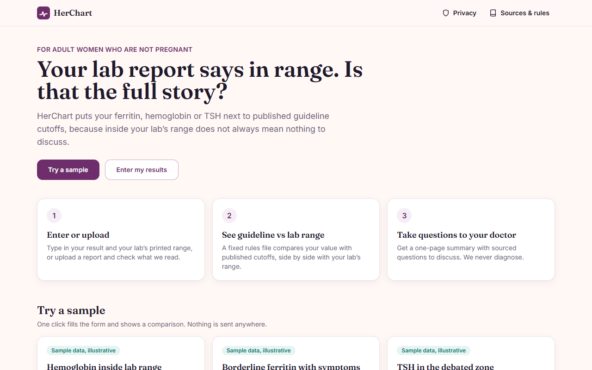
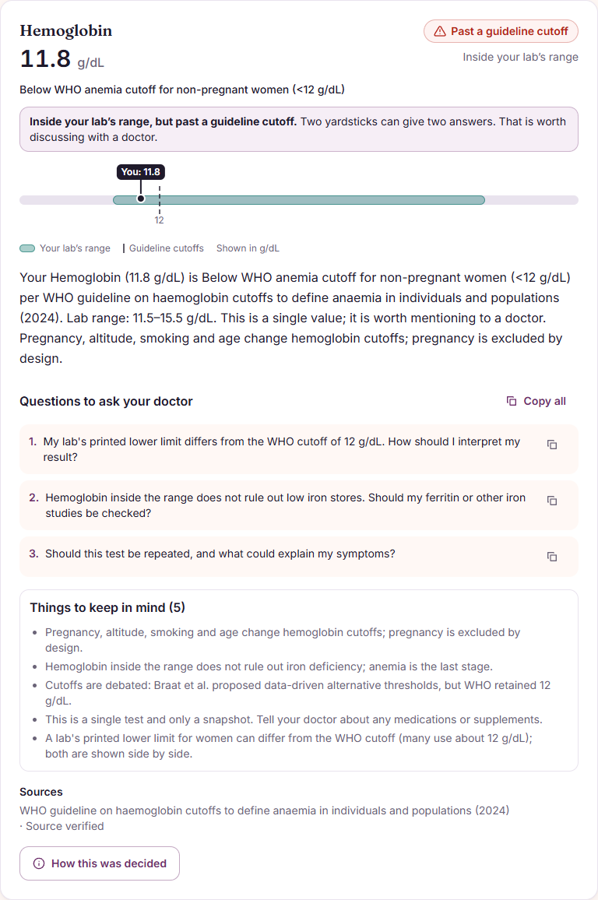
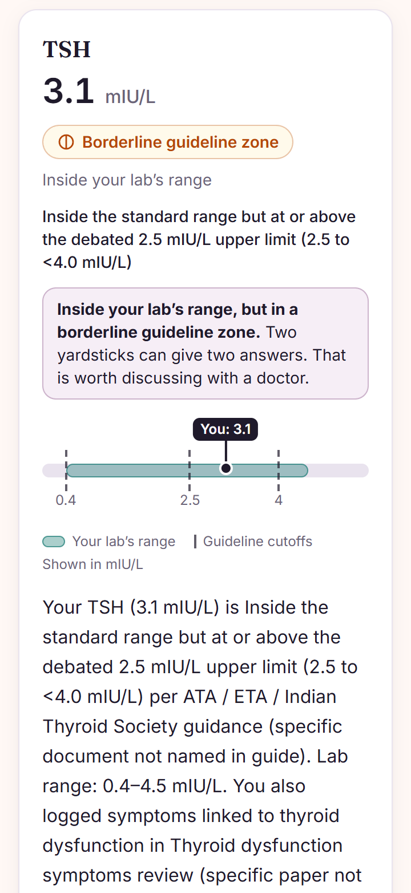
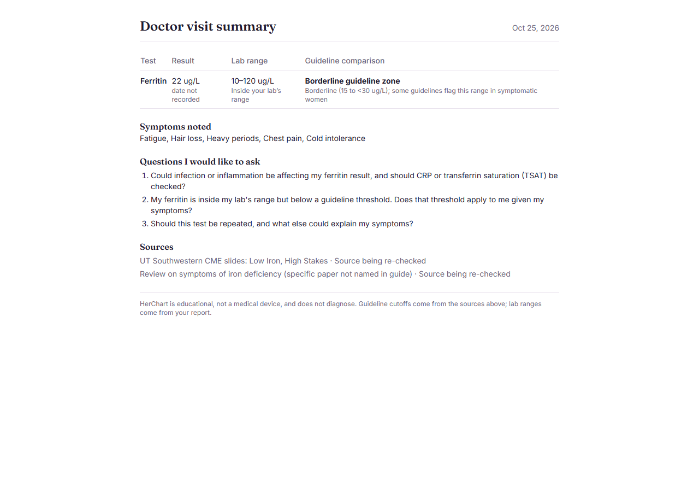
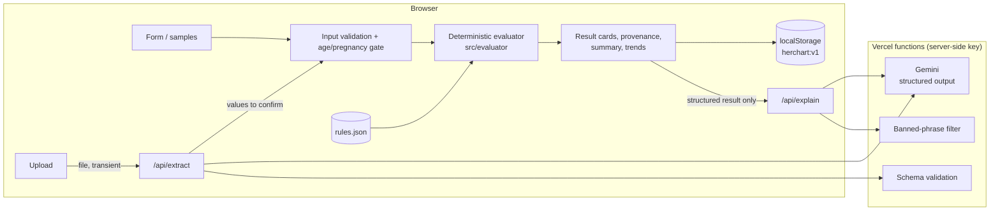

# HerChart

**Your lab report says in range. Is that the full story?**

HerChart is a privacy-first lab-result explainer for adult women who are not pregnant. It puts your **ferritin**, **hemoglobin** or **TSH** result next to published guideline cutoffs, side by side with your own lab's printed range. It also turns the comparison into questions to take to your doctor.

Live: [FILL: live URL, currently https://her-chart.vercel.app] · Repo: [FILL: repo URL] · Built for Recursion 2026, NIT Karnataka.

> HerChart is educational, not a medical device, and does not diagnose.



## The problem

A lab report prints one reference range per test and marks results as inside or outside it. Some published guidelines use different cutoffs for the same tests. For example, the WHO hemoglobin cutoff for non-pregnant women is 12 g/dL, while a lab report may print a different lower limit (our illustrative sample uses 11.5 g/dL). A result can therefore be "in range" on the report and still cross a guideline cutoff. Most people never see that second yardstick, so they don't know there is something worth asking about.

## The core insight

**Inside your lab's range does not always mean nothing to discuss.** HerChart shows both yardsticks at once and explains the gap in plain words. It never tells you what the result means for your health; that is your doctor's job.

| Hemoglobin inside the lab's range, below the WHO cutoff | Mobile view (360 px) |
|---|---|
|  |  |

## What it does

- **Try a sample:** three illustrative cases, instant, with no network calls.
- **Enter or upload:** type values with your lab's range and units, or upload a PDF/photo. Values read by AI must be checked and confirmed by you, row by row.
- **Guideline vs lab range:** a tier chip with icon and text, a range gauge, the rule's message, matched symptoms, doctor questions, caveats and sources.
- **How this was decided:** the rule id, the cutoff used, sources with verification status, the rules version and the verification-gate status.
- **Doctor visit summary:** one printable page (Save as PDF) or copy as text.
- **Trends:** saved results on this device, drawn as a timeline against your lab band and guideline lines.
- **Plain-language summary:** optional, AI-written from the structured result only, with a safety filter and a fixed-template fallback.
- **Privacy:** no account, no database. History stays in your browser; export or delete it anytime.



## Architecture



## Safety by design

1. **Deterministic rules decide everything.** Tiers and flags come only from `rules.json`, through a tested evaluator (84 tests, including every cutoff boundary). The AI never decides.
2. **The AI only extracts or rephrases.**
   - *Extraction:* Gemini returns a fixed JSON schema, and the server strictly validates it. Unknown tests are listed as "not covered", never guessed. Instructions inside the document are ignored.
   - *Explanation:* only the evaluator's structured output is sent. The prompt forbids diagnosis, treatment and doses. A banned-phrase filter runs on the server and again in the browser, and any failure falls back to a fixed template.
3. **Human in the loop.** Every extracted value must be confirmed. Values the AI read with low confidence are highlighted.
4. **Urgent banner.** Ticking chest pain, breathlessness or dizziness shows a static urgent-care message, whatever the lab values.
5. **Population gate.** Under 18, pregnant or possibly pregnant, or age missing: a friendly "not covered" screen, never a result.
6. **Provenance and honesty.** Unknown source years and links stay blank, not invented. Verification status is shown in plain words. The minimum-symptom threshold is labelled "Engineering default, not clinically validated".
7. **No key in the browser.** `GEMINI_API_KEY` is read only by the serverless functions; the client bundle contains no SDK and no key.

## Honest limitations

- **Three markers only.** More will only be added once they are properly sourced.
- **No clinician validation yet.** Several sources are still "being re-checked", and no rule has a recorded verification date. The production verification gate therefore does not pass, and the app says so in every provenance drawer.
- **Symptom threshold is an engineering default.** The 2-symptom minimum is not clinically validated.
- **Adults only.** It does not cover men, under-18s or pregnancy, and it does not adjust for altitude, smoking, inflammation or medicines (the caveats say so).
- **AI reading can be wrong.** That is why every value must be confirmed, and why manual entry works fully without AI.
- **Rate limiting is best effort.** It is in-memory per function instance.

## Sources (from `rules.json`)

"Source verified" is the status recorded in `rules.json`. No rule has a human `lastVerified` stamp yet; see `HUMAN-TO-VERIFY.md`.

| Source | Year | Link | Status |
|---|---|---|---|
| WHO guideline on use of ferritin concentrations to assess iron status in individuals and populations | 2020 | [who.int](https://www.who.int/publications/i/item/9789240000124) | Source verified |
| UT Southwestern CME slides: Low Iron, High Stakes | not recorded | not recorded | Source being re-checked |
| Galetti V, et al. Threshold ferritin and hepcidin concentrations indicating early iron deficiency in young women… eClinicalMedicine | 2021 | [PMC8350021](https://pmc.ncbi.nlm.nih.gov/articles/PMC8350021/) | Source verified |
| Review on symptoms of iron deficiency (specific paper not named in guide) | not recorded | not recorded | Source being re-checked |
| WHO Guideline on haemoglobin cutoffs to define anaemia in individuals and populations | 2024 | [who.int](https://www.who.int/publications/i/item/9789240088542) | Source verified |
| Braat S, et al. Haemoglobin thresholds to define anaemia from age 6 months to 65 years. Lancet Haematol 2024;11(4):e253-e264 | 2024 | [DOI](https://doi.org/10.1016/S2352-3026(24)00030-9) | Source verified |
| ATA / ETA / Indian Thyroid Society guidance (specific document not named in guide) | not recorded | not recorded | Source being re-checked |
| Thyroid dysfunction symptoms review (specific paper not named in guide) | not recorded | not recorded | Source being re-checked |

## Run locally

```bash
npm ci
npm test          # 84 tests: evaluator, gates, rendering, schema, guardrails, AI fallback
npm run preflight # tests + build + key/secret scans before deploying
npm run dev       # http://localhost:3000 (manual entry and samples work; AI routes need Vercel)
npm run build
```

To try the AI routes locally, use `vercel dev` with a `.env.local` that contains `GEMINI_API_KEY`.

## Deploy (Vercel)

1. Framework preset: **Vite**. Build command `npm run build`, output directory `dist`.
2. Environment variables (server-side, **no `VITE_` prefix**):
   - `GEMINI_API_KEY`: required for upload and the plain-language summary.
   - `GEMINI_MODEL`: optional. Defaults to `gemini-3.8-flash`.
3. Delete any old `VITE_GEMINI_API_KEY` variable and rotate that key (see `AUDIT.md`).
4. `api/extract.ts` and `api/explain.ts` deploy as functions automatically. `vercel.json` sets a 30 s limit and the SPA rewrite.

If the key is missing or the AI service fails, the app shows "AI features are unavailable right now, manual entry works fully". Everything else keeps working.

## Project docs

`AUDIT.md` (what was broken) · `DECISIONS.md` (why things are the way they are) · `QA.md` (manual checklist) · `DEMO_SCRIPT.md` · `PITCH.md`

## Team

[FILL: team member names and roles]
